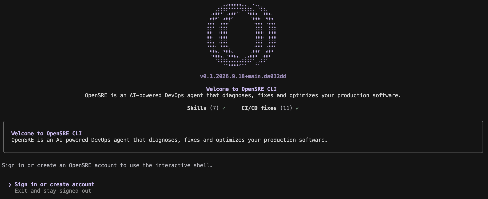
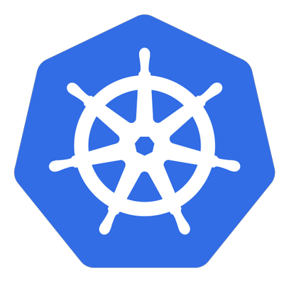

<div align="center">

<p align="center">
  
</p>

<h1>OpenSRE v0.1：构建你自己的 AI SRE 智能体</h1>

<p>面向 AI SRE 智能体的开源框架，同时提供帮助智能体持续改进的训练与评估环境。连接你正在使用的 60 多种工具，定义自己的工作流，在自己的基础设施上回答生产环境相关问题。</p>

<p align="center">
  <a href="https://github.com/Tracer-Cloud/opensre/actions/workflows/ci.yml?branch=main"></a>
<a href="https://github.com/Tracer-Cloud/opensre/releases"></a>
  <a href="https://github.com/Tracer-Cloud/opensre/blob/main/LICENSE"></a>
  <a href="https://discord.gg/7NTpevXf7w"></a>
    <a href="https://greptile.com"></a>
</p>

<p align="center">
  <a href="https://trendshift.io/repositories/25889" target="_blank">
    
  </a>
</p>

<p align="center">
  <a href="README.md">English</a> | <a href="README.zh-CN.md">简体中文</a>
</p>

<p align="center">
  <strong>
    <a href="https://www.opensre.com/docs/getting-started/quickstart">快速入门</a> ·
    <a href="https://www.opensre.com/docs">文档</a> ·
    <a href="https://opensre.com/docs/guides/faq">常见问题</a> ·
    <a href="https://trust.tracer.cloud/">安全</a>
  </strong>
</p>

</div>

---

> 🚧 公开 Alpha 阶段：核心工作流已可用于初步探索，但尚未完全稳定。项目正在积极开发中，API 和集成功能可能会发生变化。

---

## 开始之前

请确保：

- 已在代码项目目录中打开终端
- 已准备好一个 Git 仓库（建议使用，以便体验完整的工作流演示）

## 第 1 步：安装并启动 opensre

macOS 或 Linux：

```bash
curl -fsSL https://install.opensre.com | bash -s -- -gh
```

Windows（PowerShell）：

```powershell
& ([scriptblock]::Create((irm https://install.opensre.com/install.ps1))) -gh
```

然后启动 OpenSRE：

```bash
opensre
```



Windows 平台的详细说明请参阅 [Windows 安装指南](docs/install/windows-local.mdx)。

安装程序会获取 `main` 分支的最新构建，无需 sudo 权限。如果找不到 `opensre` 命令，请按照安装程序输出的提示配置 PATH，或重新打开终端。

有关支持的平台和故障排查，请参阅[本地安装指南](https://www.opensre.com/docs/install/install-local)。

---

## 目录

- [开始之前](#开始之前)
- [安装并启动 opensre](#第-1-步安装并启动-opensre)
- [为什么选择 OpenSRE](#为什么选择-opensre)
- [快速入门](#快速入门)
- [部署](#部署)
- [OpenSRE 的工作原理](#opensre-的工作原理)
- [功能与集成](#功能与集成)
- [集成列表](#集成列表)
- [贡献与开发](#贡献与开发)
- [安全](#安全)
- [遥测](#遥测)
- [许可证](#许可证)
- [参考文献](#参考文献)

---

## 为什么选择 OpenSRE

当生产环境发生故障时，相关证据往往分散在日志、指标、链路追踪、运维手册和 Slack 讨论串中。OpenSRE 是面向「能够解决生产故障的 AI SRE 智能体」的开源框架，旨在运行在你自己的基础设施上。

我们之所以这样做，是因为 SWE-bench<sup>1</sup> 已为编程智能体提供了可规模化的训练数据和明确的反馈，而生产环境故障响应仍缺乏类似的基础。

与本地代码任务相比，分布式故障的处理耗时更长、干扰信息更多，也更难模拟和评估。因此，AI SRE 以及更广泛的 AI 生产环境调试，仍有许多问题尚待解决。

OpenSRE 正在构建这一缺失的基础：

> 一个面向智能体驱动的基础设施故障响应的开放强化学习环境，并为贴近真实场景的生产故障配套端到端测试

为此，我们正在：

- 构建易于部署、可定制的 AI SRE 智能体，用于生产运维和故障响应
- 在由云环境支撑的真实场景中运行端到端测试 [(tests/e2e)](tests/e2e)
- 使用含义明确的测试目录命名，清晰区分端到端测试与单元测试、本地测试与云端测试 [(tests/README.md)](tests/README.md)

我们的使命是在此基础上构建 AI SRE 智能体，将其扩展到数千种贴近真实情况的基础设施故障场景，让 OpenSRE 成为 AI SRE 的评测基准和训练平台。

<sup>1</sup> https://arxiv.org/abs/2310.06770

---

## 快速入门

贡献者可从 [`main.py`](main.py) 开始了解进程入口结构。

运行 `opensre`，登录后即可开始使用。首次启动会激活托管模型。

```bash
opensre
```

Web 应用贡献者可以运行 `opensre setup --dev`，通过 `http://localhost:3000` 完成身份验证。

**交互式 Shell** — 不带子命令运行 `opensre` 时，它会验证账户并启动 REPL（需要 TTY）。你可以退出并保持未登录状态，但只有有效账户才能进入交互式 Shell。你可以用自然语言描述故障，观察智能体执行任务，并使用斜杠命令控制会话（`/help`、`/status`、`/cost`、`/sessions`、`/resume`、`/compact`、`/new`、`/exit`）及管理集成（`/integrations list`、`/integrations verify`）。按 Ctrl+C 可以取消正在进行的交互轮次，同时保留会话状态。完整说明请参阅 **[交互式 Shell 命令](https://www.opensre.com/docs/getting-started/interactive-shell-commands)**。

**无头 CLI（Headless CLI）** — 从终端、脚本或 CI 任务中，以非交互方式执行一轮智能体交互：

```bash
opensre ask "why is checkout-api slow?"
```

有关通过标准输入（stdin）传入提示词、JSON 输出和工具执行审批，请参阅 **[无头 CLI](https://www.opensre.com/docs/guides/headless-cli)**。

**通过 Python 调用** — 在你自己的代码中，于同一进程内调用智能体（需要检出项目源码）：

```python
from bootstrap.embedded import start_embedded_session

session = start_embedded_session()
result = session.chat("why is checkout-api slow?")
if result.answered:
    print(result.primary_response_text)
```

有关会话、对话和自定义输出接收器，请参阅 **[Python API](https://www.opensre.com/docs/guides/python-api)**。

**融入团队的日常工作流：** 将 OpenSRE 嵌入团队已经使用的 Python 服务和自动化流程。
从仓库中的 [Python API 指南](docs/guides/python-api.mdx)开始，将其用于日常工作，让故障响应流程可以重复执行。

其他实用命令：

```bash
opensre integrations setup
opensre update
opensre uninstall   # 卸载 opensre 并删除所有本地数据
```

---

## 部署

你可以选择 OpenSRE Cloud 托管网关、AWS EC2 部署或通用的自托管方案：

- **OpenSRE Cloud 托管网关：** 由组织管理员在 Web 应用中开通（provision）；已登录的 Shell 用户可以查看、启动或停止网关，无需在本地管理基础设施凭据。
- **网关（AMI + systemd）：** 先运行 `make build-gateway-image`，再运行 `make deploy-gateway`。此方案仅适用于 Telegram 网关，不使用 Docker；网关会安装到服务器镜像中，新服务器从该镜像启动。
- **自托管容器（Railway / ECS / Vercel）：** 使用仓库中的 `Dockerfile` 部署，选择 `MODE`，并设置 `LLM_PROVIDER` 及其 API 密钥。仅当网关需要由 Postgres 承载的共享状态时（例如运行 Slack Events API 多副本），才需配置 `DATABASE_URL`。

**[完整部署步骤与前提条件 → DEPLOYMENT.md](DEPLOYMENT.md)**

---

## OpenSRE 的工作原理


当你提出问题或收到告警时，OpenSRE 会自动：

1. **获取**相关上下文，以及关联的日志、指标、链路追踪和近期部署信息
2. 在调用外部大语言模型（LLM）之前，**脱敏**敏感标识符（可选）
3. 结合已连接系统的信息进行**推理**，在工具调用循环中验证假设
4. 在对话中给出关联证据的**回答**
5. **建议**后续步骤，并可按需执行修复操作
6. 直接将摘要**发送**到 Slack、PagerDuty 或 Telegram，无需切换工具

移除旧的图与链框架层后，当前智能体在代码层面的架构请参阅 [AGENTS.md](AGENTS.md)。

---

## 功能与集成

|  |  |
| --- | --- |
| 🔍 **基于证据的诊断** | 关联分析日志、指标、链路追踪、部署和配置 |
| 📋 **结合运维手册的推理** | OpenSRE 会读取你的运维手册并自动应用其中的指导 |
| 🔗 **有证据支持的根因分析** | 每个结论都关联到支持它的数据 |
| 🛡️ **可逆的标识符脱敏** | 在调用外部 LLM 前对 Pod、集群和账户 ID 进行脱敏，并在输出中还原 |
| 📊 **会话成本与历史记录** | 按会话追踪 Token 用量（`/cost`），并支持恢复 REPL 会话（`/sessions`） |
| 🤖 **灵活选择 LLM** | 自带模型 — Anthropic、OpenAI、Codex、Ollama、Gemini、OpenRouter、TrustedRouter、NVIDIA NIM、Bedrock |

OpenSRE 可连接 **60 多种**工具，涵盖 LLM、可观测性、云基础设施、数据平台、故障管理和 MCP。完整的集成一览表（含路线图链接）请参阅 **[产品文档](https://www.opensre.com/docs)**；随着项目发展，仓库中也会持续维护详细目录。

---

## 集成列表

OpenSRE 可连接现代云技术栈中的 60 多种工具与服务，从 LLM 提供商和可观测性平台，到基础设施、数据库和故障管理工具。

| 类别 | 集成 | 路线图 |
| --- | --- | --- |
| **AI / LLM 提供商** | Anthropic · OpenAI · OpenAI Codex · Ollama · Google Gemini · OpenRouter · TrustedRouter · NVIDIA NIM · Bedrock |  |
| **可观测性** |  Grafana (Loki · Mimir · Tempo · annotations) ·  Datadog · Honeycomb · Coralogix ·  groundcover ·  CloudWatch ·  Sentry · Elasticsearch · Better Stack · Splunk · Victoria Logs · SignOz · OpenObserve · OpenSearch · Azure Monitor · New Relic |  |
| **基础设施** |  Kubernetes ·  AWS (S3 · Lambda · EKS · EC2 · CloudTrail · Bedrock) ·  Azure · ArgoCD · Helm |  |
| **数据库** | MongoDB · ClickHouse · PostgreSQL · MySQL · MariaDB · MongoDB Atlas · Azure SQL · Snowflake · Redis · RDS · Supabase |  |
| **数据平台** | Apache Airflow · Apache Kafka · Prefect · RabbitMQ · Dagster · Temporal |  |
| **开发工具** |  GitHub · GitHub MCP · Bitbucket · GitLab · Jenkins |  |
| **故障管理** |  PagerDuty · Jira · Alertmanager · incident.io · ServiceNow · Trello（仅提供客户端辅助功能） | [Linear](https://github.com/Tracer-Cloud/opensre/issues/124) |
| **沟通协作** |  Slack · Google Docs · Discord · Telegram ·  Rocket.Chat · WhatsApp · Buzz | [Notion](https://github.com/Tracer-Cloud/opensre/issues/286) · [Teams](https://github.com/Tracer-Cloud/opensre/issues/138) · [Confluence](https://github.com/Tracer-Cloud/opensre/issues/313) |
| **智能体部署** |  Vercel ·  EC2 ·  ECS · Railway |  |
| **协议** |  MCP |  |

---

## 贡献与开发

OpenSRE 由社区共同构建。想找一项适合入门的贡献？可以浏览标记为 [`good first issue`](https://github.com/Tracer-Cloud/opensre/issues?q=is%3Aissue+is%3Aopen+label%3A%22good+first+issue%22) 的议题，或参阅[首次贡献指南](docs/good-first-issues/README.md)。完整流程请参阅 **[CONTRIBUTING.md](CONTRIBUTING.md)**。

**本地环境配置：** **[SETUP.md](SETUP.md)**（涵盖各平台、Windows 和 MCP）。

**仓库开发指南：** **[docs/DEVELOPMENT.md](docs/DEVELOPMENT.md)**（包含源码安装、与 CI 保持一致的检查、开发容器、部署详情和遥测参考）。

<p>
  <a href="https://discord.gg/7NTpevXf7w">
    
  </a>
</p>

<p align="center">
  <a href="https://www.star-history.com/?type=date&repos=Tracer-Cloud%2Fopensre">
    <picture>
      <source media="(prefers-color-scheme: dark)" srcset="https://api.star-history.com/chart?repos=Tracer-Cloud/opensre&type=date&theme=dark&legend=top-left&sealed_token=LHlhQArnQVcZZDuHHjU19dJHIIzQx9WzB2xacqhOnA8REEAfcVO94FgGmjAMsR8iiPA3ELR-RmF_t2rtnLLj6ieZt6S4PGbFZ5Ev1HgIrg8KJNkJDYQob_BcV8MtWc2wQnahPyKX6B9PgqvoQxI7E6B6SkW7gXQEq1xLLGDZ2JHvv5b3kr7SYnUpq98y" />
      <source media="(prefers-color-scheme: light)" srcset="https://api.star-history.com/chart?repos=Tracer-Cloud/opensre&type=date&legend=top-left&sealed_token=LHlhQArnQVcZZDuHHjU19dJHIIzQx9WzB2xacqhOnA8REEAfcVO94FgGmjAMsR8iiPA3ELR-RmF_t2rtnLLj6ieZt6S4PGbFZ5Ev1HgIrg8KJNkJDYQob_BcV8MtWc2wQnahPyKX6B9PgqvoQxI7E6B6SkW7gXQEq1xLLGDZ2JHvv5b3kr7SYnUpq98y" />
      
    </picture>
  </a>
</p>

感谢以下贡献者：

<!-- readme: contributors -start -->
<a href="https://github.com/Tracer-Cloud/opensre/graphs/contributors">
  
</a>
<!-- readme: contributors -end -->

---

## 安全

OpenSRE 的设计充分考虑生产环境需求：LLM 提示词结构化且可审计，对话记录默认在本地处理，不会在未告知的情况下批量导出原始日志。有关负责任的漏洞披露，请参阅 **[SECURITY.md](SECURITY.md)**。

---

## 遥测

产品使用情况分析和 Sentry 错误监控**默认启用，可自行关闭**。快速关闭方式：

```bash
export OPENSRE_NO_TELEMETRY=1
```

**[完整配置一览表、DSN 覆盖设置与本地事件日志 → docs/DEVELOPMENT.md](docs/DEVELOPMENT.md#telemetry-and-privacy)**

---

## 许可证

Apache 2.0 — 详见 [LICENSE](LICENSE)。

## 参考文献

<sup>1</sup> https://arxiv.org/abs/2310.06770
